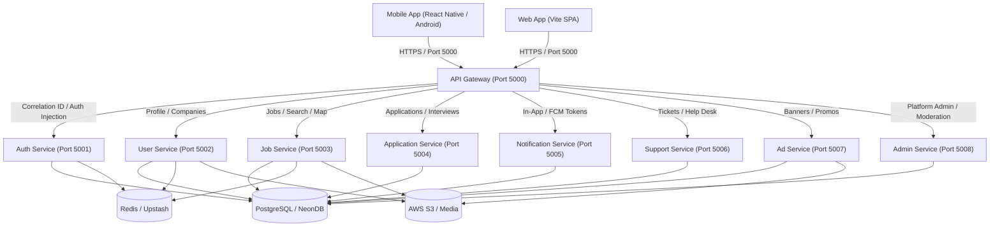

# Report 1: Complete Backend Architecture & System Discovery

**Platform:** JobMarket Industrial Platform (Web & Mobile Backend)  
**Evaluator:** Senior Backend Architect, Application Security Engineer, Database & SRE Auditor  
**Date:** October 14, 2026  
**Audit Target:** Dual Monolith & Distributed Microservices Architecture  
**Active Production URL:** `https://jobmarket-8c0p.onrender.com`  
**Local Test Cluster:** `http://localhost:5000` (Ports 5000–5008)  

---

## 1. Architectural Overview

JobMarket operates a hybrid dual-deployment architecture:
1. **Monolithic Unified Engine:** Located in `backend/src/app.ts` and `backend/src/server.ts`, offering an all-in-one Express server mounting all route modules.
2. **Distributed Microservices Cluster:** Managed via `backend/start_microservices.ts` and orchestrated via an edge **API Gateway** (`backend/services/api-gateway/src/app.ts`) which acts as the reverse-proxy fronting 8 discrete internal microservices.

---

## 2. Core Service Inventory & Responsibilities

| Service Name | Port | Primary Responsibilities | Dependencies | Trust Boundary |
|---|---|---|---|---|
| **API Gateway** | `5000` | Ingests all traffic, injects correlation ID (`x-correlation-id`), strips spoofed identity headers, decodes JWT, verifies real-time session revocation, serves static SPA assets. | Internal microservices, Redis | **Public Edge (Internet facing)** |
| **Auth Service** | `5001` | Signup, OTP generation & verification, Login, Google OAuth, Refresh token rotation, 2FA/MFA, Session revocation (`/logout`, `/logout-all`). | PostgreSQL, Redis, Brevo API | Internal Cluster |
| **User Service** | `5002` | User profiles (`/me`, `/profile`), resume uploads, presigned S3 URLs, profile pictures, company directories. | PostgreSQL, Redis, AWS S3 | Internal Cluster |
| **Job Service** | `5003` | Job post lifecycle (create, update, delete), categories, skills, saved jobs, geocoding, Google Maps URL resolution. | PostgreSQL, Redis, AWS S3 | Internal Cluster |
| **Application Service** | `5004` | Job applications (`applyToJob`), applicant tracking, interview scheduling, interview status updates, candidate notifications. | PostgreSQL, Brevo Email, FCM | Internal Cluster |
| **Notification Service** | `5005` | In-app notification center, unread counters, mark as read, bulk clear, FCM mobile device token registration. | PostgreSQL, Firebase Admin SDK | Internal Cluster |
| **Support Service** | `5006` | Support ticket creation, ticket messaging, priority handling, help desk admin portal & analytics. | PostgreSQL, AWS S3 | Internal Cluster |
| **Ad Service** | `5007` | Homepage banners, employer advertisements, click/view telemetry, admin approval/rejection workflows. | PostgreSQL, AWS S3 | Internal Cluster |
| **Admin Service** | `5008` | Platform executive dashboard, user bans/moderation, job approvals, skill/category CRUD, system settings, broadcast notifications. | PostgreSQL, Firebase Admin SDK | Internal Cluster |

---

## 3. Technology Stack & Runtime Environment

- **Runtime:** Node.js (v22.13.0) / TypeScript (v7.0.2) via `npx tsx`
- **Web Framework:** Express 5.2.1
- **Database Engine:** PostgreSQL (Neon Serverless PostgreSQL with SSL `verify-full`)
- **Database Client & Driver:** `pg` (v8.22.0) with custom `Pool` configuration
- **In-Memory Cache & Key-Value Store:** Redis 6.1.0 (`redisClient`) with automatic in-memory fallback
- **Event Messaging:** Apache Kafka (`kafkajs` v2.2.4) with background consumer worker (`kafkaConsumerWorker.ts`)
- **Object Storage:** AWS S3 (`@aws-sdk/client-s3` v3.1119.0) for resumes, profile pictures, support attachments, and banner media
- **Email Gateway:** Brevo (Sendinblue) transactional REST API / SMTP
- **Push Notification Gateway:** Firebase Admin SDK (v13.10.0) FCM (Cloud Messaging)
- **Security Middleware:** Helmet 8.3.0, CORS 2.8.6, Winston 3.19.0, Zod 4.4.3, Bcrypt 6.0.0, JSONWebToken 9.0.3

---

## 4. Trust Boundaries & Security Architecture

1. **Edge Boundary (API Gateway):**
   - The Gateway accepts public requests from mobile clients and web browsers.
   - **Header Sanitization:** In `authHeaderInjector.ts`, client-supplied `x-user-id`, `x-user-role`, and `x-session-id` headers are deleted before JWT verification.
   - **Real-Time Revocation:** The gateway checks `SessionRepository.isSessionRevoked(sessionId)` on each request with a Bearer token.
2. **Downstream Service Boundary:**
   - In production, internal services (ports 5001–5008) must bind to `127.0.0.1` or internal VPC networks, inaccessible directly from the public internet.
   - If downstream services do not enforce authentication middleware, relying solely on path-based gateway routing, route exposure or misconfiguration causes critical privilege escalation (documented in Report 3).

---

## 5. Critical Architectural Bottlenecks & Failure Points

1. **PostgreSQL Connection Pool Sizing:**
   - Each of the 9 microservices initializes its own `new Pool({ max: 10 })`.
   - Total potential database connections: **9 × 10 = 90 connections**.
   - Under horizontal scaling (e.g. 2 or 3 instances of each service on Render), connection count will spike to **180–270 connections**, instantly exhausting Neon PostgreSQL connection limits unless a PgBouncer / Neon Pooling proxy is used.
2. **In-Memory Cluster State:**
   - Rate limiting falls back to local in-memory `Map` when Redis is unavailable. If multiple instances run across nodes, rate limits become non-shared.
   - Bounded revocation set (`localRevokedSessions`) in `SessionRepository` is process-local; multi-instance deployments require Redis Pub/Sub for instant cluster-wide revocation synchronization.
3. **CORS Configuration:**
   - `api-gateway/src/app.ts` sets `origin: (origin, callback) => callback(null, true)` with `credentials: true`. This allows arbitrary web pages to execute cross-origin authenticated credentialed requests.

---

## 6. Architecture Status & Verification

| Architectural Domain | Baseline Status | Risk Level |
|---|---|---|
| Service Segmentation | **PASS** (Clear separation of concerns across 9 services) | Low |
| Gateway Routing & Header Injection | **PASS** (Spoofed headers stripped; valid identities injected) | Low |
| Database Connection Pooling | **PARTIAL** (No centralized connection pooler; high risk under replica scaling) | High |
| In-Memory Fallbacks | **PASS** (Redis outages do not crash backend) | Low |
| Static Asset Delivery | **PASS** (Single Page App fallback with smart crawler OpenGraph injection) | Low |
