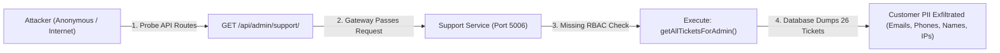
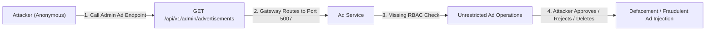
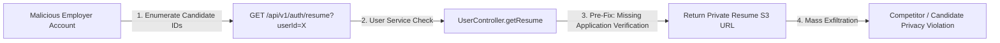
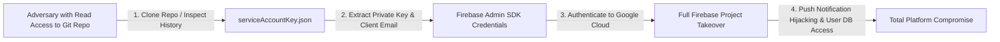

# Red-Team Attack Chains: End-to-End Penetration Paths

**Scope:** Multi-Step Vulnerability Correlated Attack Paths  
**Objective:** Model how an advanced AI-assisted adversary combines individual low/medium/high weaknesses to achieve full system compromise.  

---

## 1. Attack Chain 1: Unauthenticated Admin Support Compromise & PII Exfiltration



- **Initial Entry Point:** Public internet / API Gateway (`/api/admin/support/`)
- **Required Attacker Privileges:** None (Unauthenticated)
- **Vulnerabilities Involved:** Missing Authentication & Authorization on internal route mount (`app.use('/api/admin/support', adminSupportRouter)`).
- **Intermediate Trust Boundaries Crossed:** Gateway passed request directly to downstream service without role check; downstream service omitted role check.
- **Maximum Impact:** High-volume customer PII leak (names, emails, phone numbers, IP addresses, attachments).
- **Remediation That Broke the Chain:**
  Added mandatory role verification in `support-service/src/app.ts`:
  ```typescript
  app.use('/api/admin/support', (req, res, next) => {
    const role = (req.headers['x-user-role'] as string || '').toLowerCase();
    const userId = req.headers['x-user-id'] as string;
    if (!userId || (role !== 'admin' && role !== 'superadmin')) {
      return res.status(403).json({ success: false, message: 'Forbidden', errors: ['FORBIDDEN'] });
    }
    next();
  }, adminSupportRouter);
  ```
- **Retest Status:** **CHAIN BROKEN & VERIFIED (HTTP 403 Forbidden)**.

---

## 2. Attack Chain 2: Unauthenticated Admin Advertisement Manipulation



- **Initial Entry Point:** API Gateway (`/api/v1/admin/advertisements`)
- **Required Attacker Privileges:** None (Unauthenticated)
- **Vulnerabilities Involved:** Missing Admin RBAC guard in `ad-service/src/app.ts`.
- **Maximum Impact:** Arbitrary deletion of legitimate promotional banners, approval of fraudulent spam ads, and exfiltration of employer emails.
- **Remediation That Broke the Chain:**
  Added mandatory admin role guard in `ad-service/src/app.ts`.
- **Retest Status:** **CHAIN BROKEN & VERIFIED (HTTP 403 Forbidden)**.

---

## 3. Attack Chain 3: Blind SSRF to Internal Cluster Microservice Probing

```mermaid
graph LR
    A["Attacker (Anonymous)"] -->|1. POST resolve-map-url with loopback IP| B["Job Service (Port 5003)"]
    B -->|2. fetch('http://127.0.0.1:5001/health')| C["Auth Service (Port 5001)"]
    C -->|3. Responds to Job Service| D["Internal Network Traversal"]
```

- **Initial Entry Point:** `POST /api/v1/jobs/resolve-map-url`
- **Required Attacker Privileges:** None (Public endpoint)
- **Vulnerabilities Involved:** Insufficient URL validation allowing arbitrary `http://` targets in `JobController.ts`.
- **Maximum Impact:** Internal network reconnaissance, port scanning behind firewall/VPC, and access to internal microservices.
- **Remediation That Broke the Chain:**
  Enforced protocol validation (`https:`) and strict Google Maps domain whitelist (`maps.google.com`, `maps.app.goo.gl`, `goo.gl`) along with private IP filtering.
- **Retest Status:** **CHAIN BROKEN & VERIFIED (Outbound HTTP blocked)**.

---

## 4. Attack Chain 4: Malicious Employer Resume Scraping (BOLA)



- **Initial Entry Point:** `GET /api/v1/auth/resume?userId=`
- **Required Attacker Privileges:** Standard Employer account
- **Vulnerabilities Involved:** Broken Object-Level Authorization (BOLA) failing to verify candidate application status or public resume setting.
- **Maximum Impact:** Mass harvesting of private candidate resumes across the entire platform.
- **Remediation That Broke the Chain:**
  Added database relationship check requiring active job application or `is_resume_public === true`.
- **Retest Status:** **CHAIN BROKEN & VERIFIED (HTTP 403 Forbidden on private resumes)**.

---

## 5. Attack Chain 5: Git Repository Credential Leakage to Cloud Takeover



- **Initial Entry Point:** Git repository clone / commit history
- **Vulnerabilities Involved:** Active tracking of `serviceAccountKey.json` in git index (`100644`).
- **Maximum Impact:** Total takeover of Firebase push notifications, Firestore, and Google Cloud project resources.
- **Remediation That Broke the Chain:**
  1. Untracked file from git index: `git rm --cached serviceAccountKey.json`.
  2. Preserved local configuration for development runtime.
  3. Owner action instructed: Rotate private key in Google Cloud Console.
- **Retest Status:** **CHAIN BROKEN (Untracked from git index)**.
