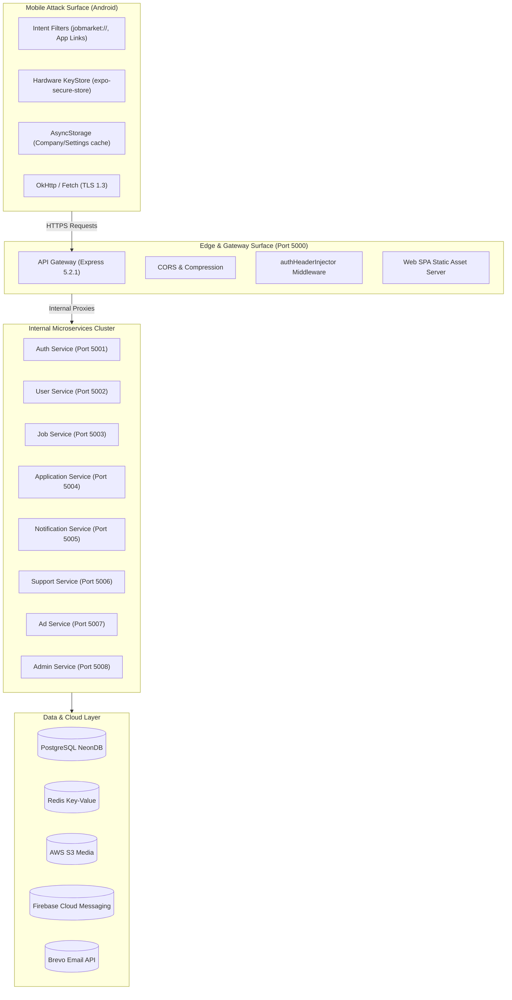

# Red-Team Attack Surface Mapping

**Scope:** Mobile App + Web SPA + API Gateway + 8 Microservices + Cloud Stores  

---

## 1. Complete Attack Surface Inventory

---

## 2. Mobile Client Attack Surface

| Surface Component | Exposure Vector | Configuration | Threat Model / Attacker Vector |
|---|---|---|---|
| **Exported Activity** | `.MainActivity` (`android:exported="true"`) | Handles App Links & custom scheme | Malicious apps sending crafted intents with malformed paths. |
| **Deep Link Scheme** | `jobmarket://job/*` | Implicit Intent filter | Path traversal or deep link hijacking by a malicious app. |
| **Android App Links** | `https://job-market-wine.vercel.app/job/*` | `autoVerify="true"` | Domain spoofing if assetlinks.json is misconfigured. |
| **Token Storage** | `csn_employer_access_token` | `expo-secure-store` | Rooted device physical extraction / backup exfiltration (`android:allowBackup="false"` blocks backup). |
| **Non-Sensitive Cache** | `AsyncStorage` | Cleartext SQLite on Android | Cache pollution of company search suggestions. |
| **Network Client** | React Native `fetch` / Axios | Bound to `API_BASE_URL` | Man-in-the-middle (MITM) proxy inspection on untrusted Wi-Fi. |

---

## 3. API Gateway & Network Edge Surface

- **Public Port:** `5000` (Directly exposed on Render: `https://jobmarket-8c0p.onrender.com`)
- **Header Processing (`authHeaderInjector.ts`):**
  - Ingress: Deletes incoming `x-user-id`, `x-user-role`, `x-session-id`.
  - Token Decoding: Decodes `Authorization: Bearer <token>` using `JWT_ACCESS_SECRET`.
  - Database Call: Executes real-time `isSessionRevoked(sessionId)`.
  - Downstream Egress: Injects verified identity headers to internal proxy targets.
- **CORS Surface:** Configured to accept incoming cross-origin browser requests; requires strict origin validation to prevent malicious website cross-origin reads.
- **Request Limits:** `express.json({ limit: '50mb' })` accepts JSON payloads up to 50MB.

---

## 4. Microservices Surface & Trust Boundaries

| Service | Port | Ingress Surface | Trust Boundary Policy |
|---|---|---|---|
| **auth-service** | `5001` | `/api/v1/auth/signup`, `/login`, `/refresh`, `/otp` | Public edge routes; rate limited (`authLimiter`: 20 req/60s). |
| **user-service** | `5002` | `/api/v1/auth/me`, `/profile`, `/resume`, `/public-profile/:id` | Authenticated routes; requires `x-user-id` from gateway. |
| **job-service** | `5003` | `/api/v1/jobs`, `/search`, `/map`, `/resolve-map-url`, `/:id/report` | Mixed: Public discovery routes + Authenticated mutating routes. |
| **application-service** | `5004` | `/api/v1/jobs/applied/*`, `/:id/apply`, `/:id/applicants`, `/interviews` | Strict RBAC: Candidate-only (`apply`) vs Employer-only (`applicants`). |
| **notification-service**| `5005` | `/api/v1/notifications/*`, `/device-token` | Authenticated user scope (`user_id = x-user-id`). |
| **support-service** | `5006` | `/api/support/tickets`, `/api/admin/support/*` | Mixed: Guest tickets + Authenticated user + Admin RBAC guard. |
| **ad-service** | `5007` | `/api/v1/home/ads`, `/employer/ads`, `/api/v1/admin/ads` | Mixed: Public banner views + Employer ads + Admin RBAC guard. |
| **admin-service** | `5008` | `/api/v1/admin/*`, `/settings` | Strict RBAC: Requires `role === 'admin'` or `'superadmin'`. |

---

## 5. Persistence & Cloud Surface

1. **PostgreSQL (NeonDB):**
   - Tables: `users`, `sessions`, `jobs`, `job_applications`, `saved_jobs`, `support_tickets`, `support_messages`, `advertisements`, `reports`, `audit_logs`, `companies`.
   - Sensitive Columns: `password_hash`, `refresh_token_hash`, `two_factor_secret`, `phone`, `email`.
2. **Redis Cache:**
   - Keys: `ratelimit:*`, `registration:OTP:*`, `2fa:OTP:*`, `user:profile:*`, `search:jobs:*`.
3. **AWS S3:**
   - Bucket: Resumes (`resumes/`), Profile Avatars (`profiles/`), Support Attachments (`support/`), Ads (`banners/`).
   - Access: Signed presigned URLs and server-mediated S3 client upload.
